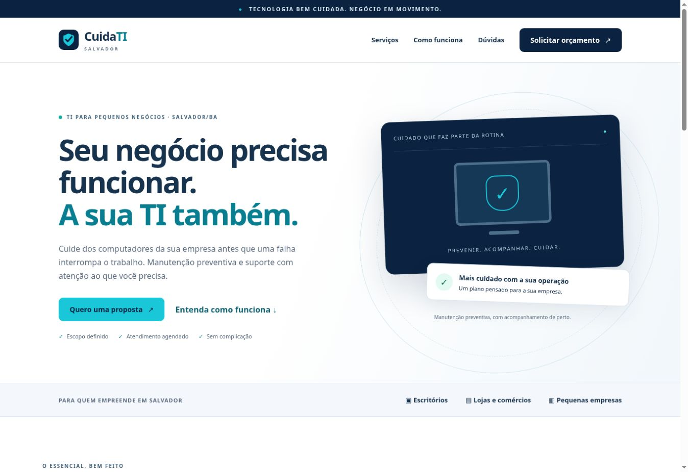

# CuidaTI Salvador

MVP de manutenção preventiva de computadores para pequenos negócios de Salvador/BA. A página pública recebe pedidos de proposta; o painel acompanha interessados, clientes e visitas. Negociação, pagamento e confirmação da agenda continuam manuais pelo WhatsApp.

**Estado real da entrega:** aplicação publicada em [https://cuidati-salvador.netlify.app/](https://cuidati-salvador.netlify.app/), com função Netlify e migração PostgreSQL aplicada. O administrador e o WhatsApp comercial ainda precisam ser configurados pelo responsável. Nenhuma contratação ou pesquisa com clientes foi realizada. O projeto foi construído diretamente aqui, sem Lovable.

## Dor e proposta

Pequenos negócios sem equipe própria de TI podem depender de atendimento corretivo quando um computador falha. A proposta do CuidaTI é oferecer manutenção preventiva agendada, histórico dos cuidados e suporte com limites definidos em contrato. O público inicial são escritórios, lojas e pequenas empresas com cerca de 3 a 20 computadores.

**Hipótese:** essas empresas aceitam pagar por atendimento recorrente em vez de procurar suporte apenas após uma falha. Ainda não validada. O serviço não promete eliminar falhas, suporte ilimitado ou disponibilidade 24 horas. Peças, licenças, recuperação de dados e serviços adicionais exigem orçamento separado.

## Mercado e Business Model Canvas

O modelo de dimensionamento e o Canvas estão em [docs/negocio.md](docs/negocio.md). Os cenários são exercícios com premissas explícitas, não estatísticas comprovadas de Salvador. TAM e SAM numéricos dependem de levantamento de empresas e entrevistas. Não confundir interesse no formulário com receita ou demanda validada.

## Funcionalidades

- Landing page responsiva em português, com serviços, etapas, perguntas frequentes e formulário.
- Validação no navegador e servidor, limite de tentativas, campo antispam e desafio simples de soma.
- Pedidos gravados antes da confirmação; identificador de envio evita duplicações em novas tentativas.
- Link para WhatsApp com os dados do pedido, somente se houver número configurado.
- Login de administrador, senha derivada com scrypt e cookie HttpOnly/SameSite.
- Listagem, busca, filtros, observações e status dos interessados.
- Conversão transacional e idempotente em cliente, preservando o interessado.
- Edição de clientes, serviços, mensalidade opcional e situação.
- Cadastro e edição de visitas, histórico e próxima manutenção.
- Indicadores e lembretes no painel. Datas exibidas no fuso de Salvador.
- Exclusão de interessado mediante confirmação. Se convertido, dados do cliente e seu histórico são preservados; isso não equivale a uma exclusão de todos os dados pessoais.
- Contatos comerciais configuráveis, sem números, clientes ou depoimentos inventados.

## Tecnologia

A versão Netlify usa página estática, Netlify Functions e PostgreSQL persistente via `@netlify/database`. A versão local/tradicional preserva Node.js 24, servidor HTTP nativo e SQLite pelo módulo `node:sqlite`. HTML, CSS e JavaScript em módulos, sem CDN. O navegador não usa localStorage como banco e não recebe tokens por JavaScript. Os testes PostgreSQL usam PGlite como dependência de desenvolvimento.

O módulo `node:sqlite` pode emitir aviso de API experimental conforme a versão do Node. Use Node 24 atualizado. Uma instância da aplicação é a configuração suportada neste MVP.

## Executar localmente

Para executar todas as suítes de teste, instalar primeiro as dependências com `npm ci`. A instalação local abaixo usa SQLite. A configuração do administrador Netlify é separada e está em [docs/netlify.md](docs/netlify.md).

Instale Node.js 24. Na pasta do projeto:

```bash
npm run admin:create
npm start
```

Abra `http://localhost:3000`. O painel fica em `http://localhost:3000/admin`.

O comando de administrador solicita e-mail e senha em terminal interativo, com senha oculta. Não há cadastro público, credenciais padrão ou senha versionada. Execute o mesmo comando com o mesmo e-mail para redefinir a senha e invalidar as sessões anteriores. O diretório do banco deve ser o mesmo usado pelo servidor.

Para personalizar o ambiente:

```bash
cp .env.example .env
node --env-file=.env scripts/create-admin.js
node --env-file=.env server/index.js
```

O Node não lê `.env` automaticamente: use `--env-file` ou injete variáveis pelo provedor. Não envie `.env` nem `data/` ao GitHub.

No primeiro acesso, configure WhatsApp, e-mail e horário na aba Configurações. Sem WhatsApp, os pedidos continuam sendo gravados e o link não é exibido.

## Testes

```bash
npm run check
npm test
```

Testes cobrem validação, páginas, restrição das APIs, CSRF, login, desafio de envio, idempotência, persistência, conversão, edição de clientes, visitas, configurações, exclusão, logout e bloqueio de tentativas. Há 13 testes para a versão SQLite e 10 para a versão Netlify/PostgreSQL. Testes locais não comprovam publicação ou homologação no navegador. A automação de CI está em [.github/workflows/ci.yml](.github/workflows/ci.yml). O roteiro de validação manual está em [docs/testes.md](docs/testes.md).

## Publicar

**Opção atual: Netlify.** A adaptação está em [netlify.toml](netlify.toml), [netlify/functions/api.mjs](netlify/functions/api.mjs) e [docs/netlify.md](docs/netlify.md), com PostgreSQL persistente e migrações versionadas. A versão está publicada em https://cuidati-salvador.netlify.app/. A configuração do administrador e dos contatos comerciais continua pendente; veja [docs/publicacao.md](docs/publicacao.md).

A configuração Render abaixo fica como alternativa; não é necessária para Netlify.

A configuração para hospedagem no Render está em [render.yaml](render.yaml), com instruções em [docs/render.md](docs/render.md). Ela requer serviço pago e disco persistente. A publicação ainda depende de conectar a conta, revisar o custo e criar o serviço; nenhum recurso foi contratado.

Na alternativa de servidor tradicional, o backend SQLite precisa de **Node 24 e disco persistente**, além de HTTPS no proxy reverso. Na Netlify, Functions e PostgreSQL substituem esse servidor. GitHub guarda o código; GitHub Pages sozinho não executa o backend.

1. Envie este projeto para um repositório público chamado `cuidati-salvador`.
2. Em um servidor ou provedor compatível, execute o [Dockerfile](Dockerfile) ou `npm start`.
3. Monte um volume persistente em `/app/data` no Docker ou configure `DATA_DIR` para o disco persistente do provedor.
4. Configure `NODE_ENV=production` e `APP_ORIGIN=https://seu-dominio` (origem exata, sem barra final). Cookies de produção exigem HTTPS.
5. No mesmo servidor/volume, execute `npm run admin:create` em console interativo.
6. Configure os contatos e execute o roteiro manual antes de receber pedidos reais.
7. Adicione o endereço real publicado a este README e capture as telas para a entrega do desafio.

Exemplo de execução do container, **após configurar o domínio e o proxy HTTPS**:

```bash
docker build -t cuidati-salvador .
docker volume create cuidati-data
docker run -d --name cuidati --restart unless-stopped \
  -p 127.0.0.1:3000:3000 \
  -v cuidati-data:/app/data \
  -e APP_ORIGIN=https://seu-dominio \
  cuidati-salvador
docker exec -it cuidati npm run admin:create
```

Serviços de hospedagem podem cobrar por disco e execução. Nenhum recurso pago foi contratado ou criado neste trabalho. Use somente uma instância com o mesmo SQLite. Faça backups com a API de backup do SQLite ou com a aplicação parada; copiar só o arquivo principal com o banco em uso pode perder transações no WAL.

## Segurança e limites

- APIs administrativas exigem sessão verificada no servidor, inclusive alterações de configuração.
- Toda mutação exige `Origin` igual a `APP_ORIGIN`; não existe CORS liberado para terceiros.
- Sessões expiram em 8 horas; cookies de produção usam `Secure`.
- Login limitado por IP e janela de 15 minutos; pedidos públicos limitados a 12 por IP nessa janela.
- O desafio de soma é uma barreira básica, não um CAPTCHA robusto. Antes de tráfego amplo, considere proteção antibot no proxy.
- `TRUST_PROXY=1` só deve ser habilitado quando o proxy confiável substituir `X-Forwarded-For`; caso contrário, mantenha `0`. Sem essa configuração atrás de proxy, vários clientes podem compartilhar o mesmo limite.
- Não há e-mail automático, recuperação de senha por e-mail, pagamentos, área de cliente, chatbot, acesso remoto ou coleta de arquivos.
- O MVP carrega as listas administrativas completas; paginação deve ser adicionada se o volume crescer.
- Defina contato público, responsável pelo tratamento, prazo de retenção e política de privacidade adequados à operação antes de coletar dados reais.

## IA e registro das decisões

O briefing e as decisões de implementação estão em [docs/mega-prompt.md](docs/mega-prompt.md) e [docs/correcoes.md](docs/correcoes.md). A documentação distingue funcionalidades testadas de validação de mercado ainda pendente.

## Pendências da entrega DIO

- [x] Repositório público na conta do autor: https://github.com/JorgeHenriqueAlvin/cuidati-salvador
- [x] Aplicação publicada com HTTPS, Netlify Functions e PostgreSQL persistente.
- [ ] Administrador configurado e contatos comerciais reais.
- [ ] Teste no celular e revisão completa do roteiro manual.
- [x] Print real da landing page em [docs/screenshots/landing-publicada.jpg](docs/screenshots/landing-publicada.jpg).
- [ ] Prints do formulário em uso e do painel autenticado.
- [ ] Validação com pelo menos uma pessoa real documentada com autorização e sem expor seus dados.
- [x] URL publicada inserida neste README: https://cuidati-salvador.netlify.app/

Não apresentar esta lista pendente como concluída antes da execução.

## Aplicação publicada

[Abrir CuidaTI Salvador](https://cuidati-salvador.netlify.app/)


